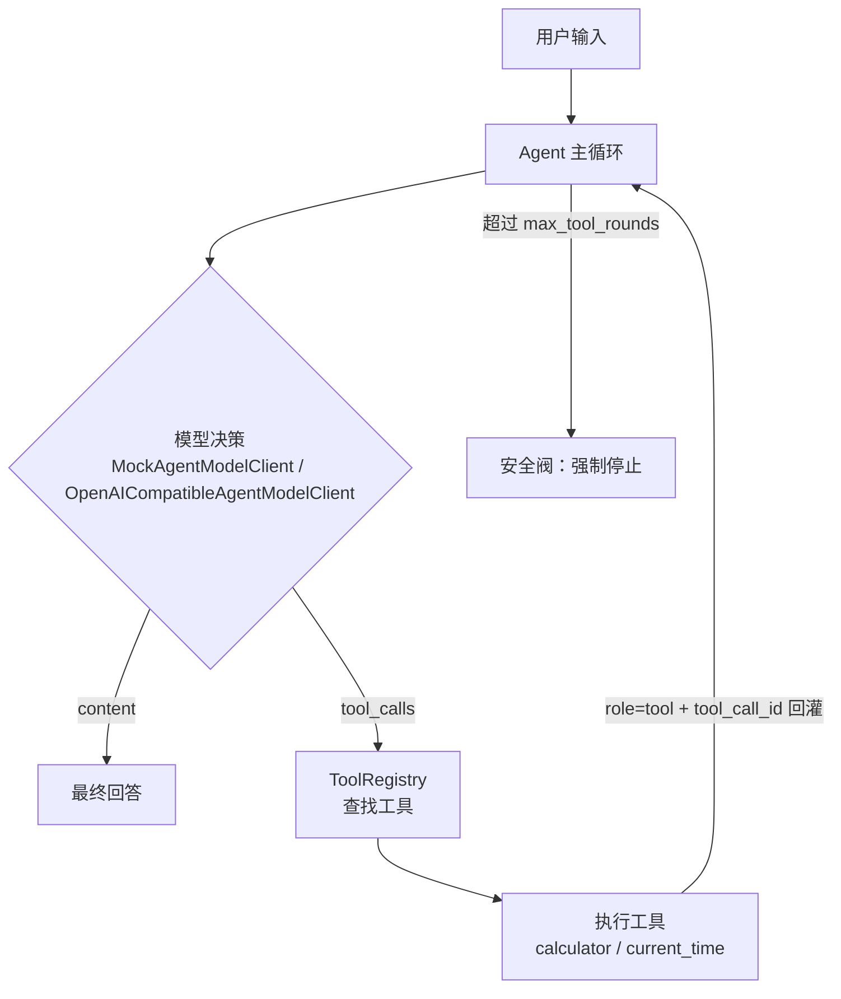

# 03 · AI Agent Workflow（ai-agent-workflow）

作品集第 03 个正式项目：**具备工具调用能力的最小 AI Agent**——学习 Agent 的核心原理
（模型决策 → 工具执行 → 结果回灌 → 最终回答），不依赖任何 Agent 框架。

## 当前开发阶段

**第二阶段（已完成）：接入真实 LLM Tool Calling。** 新增 `OpenAICompatibleAgentModelClient`
（已验证目标：智谱 GLM 开放平台，OpenAI 兼容 function calling），由真实模型决定何时调用哪个工具；
工具 JSON Schema 从 `Tool` 定义自动生成（单一事实来源）。第一阶段 Mock 模式的全部能力与测试原样保留。

## Agent 工作流



关键机制：

1. **决策与执行分离**：模型只决定「调用哪个工具、传什么参数」；执行与安全边界在 `ToolRegistry`；
2. **观察回灌**：assistant 消息携带 `tool_calls`，工具结果以 `role=tool` 消息 + `tool_call_id`
   回到对话（与 OpenAI 兼容语义一致），模型据此继续决策；
3. **安全阀**：`max_tool_rounds` 限制循环轮数，防止无限调用；异常作为观察回灌而不是崩溃；
4. **单一事实来源**：工具的 JSON Schema 由 `Tool.parameters` 自动生成，无需为 API 重复定义。

## 模块职责

| 模块 | 职责 |
| --- | --- |
| `tools.py` | `Tool` 数据类、`ToolRegistry`（注册/列举/执行）；内置工具：`calculator`（AST 白名单求值，**不使用 eval**）、`current_time` |
| `model.py` | `Message`/`ToolCall`/`ModelReply` 结构；`AgentModelClient` Protocol；`MockAgentModelClient`（规则决策）；`OpenAICompatibleAgentModelClient`（真实 function calling + Schema 生成 + 消息转换 + 响应解析） |
| `config.py` | `AGENT_MODE`/`LLM_API_KEY`/`LLM_BASE_URL`/`GENERATION_MODEL`/`LLM_TIMEOUT_SECONDS` → `Settings`；real 模式必填校验；密钥掩码 |
| `http_transport.py` | 共享 HTTP 层：httpx 异常/状态码 → `Agent*` 异常（与 01/02 同方案） |
| `factory.py` | 按 `AGENT_MODE` 创建 Mock 或真实模型客户端 |
| `agent.py` | `Agent` 主循环（服务商无关） |
| `errors.py` | `AgentError` 体系（工具/模型/网络/配置）与友好提示 |
| `logging_setup.py` | 入口处日志配置；决策与执行全程留痕 |
| `__main__.py` | 演示：按配置装配，三个问题分别走「工具」「工具」「无工具」路径 |

## 环境准备

- Python >= 3.11（本机默认 3.14，见 `.python-version`；CI 矩阵为 3.11 + 3.14）
- Mock 模式：零密钥、离线、免费；real 模式：需要你自己的智谱 API Key（本地 `.env` 自填）

## 安装

```bash
cd projects/03-ai-agent-workflow
py -3.14 -m venv .venv                  # 本机 Git Bash 的 python 是 MSYS2 版，请用 py 启动器
source .venv/Scripts/activate           # PowerShell: .venv\Scripts\Activate.ps1
python -m pip install -e ".[dev]"
```

## 运行方式一：Mock 模式（默认，无需密钥）

```bash
python -m ai_agent_workflow
```

三个示例问题分别演示「计算器工具」「时间工具」「无工具直答」，全程离线。

## 运行方式二：real 模式（智谱 GLM function calling）

1. 在**本机**把 `.env.example` 复制为 `.env`；
2. 把 `AGENT_MODE` 改为 `real`，取消注释并填写：
   - `LLM_BASE_URL=https://open.bigmodel.cn/api/paas/v4/`（官方公开文档值）
   - `LLM_API_KEY=<你的智谱 API Key>`（只写在这里，绝不提交、绝不发给别人）
   - `GENERATION_MODEL=<官方模型名，需支持函数调用，如官方示例中的 glm-5.3>`
3. 运行同一条命令：

```bash
python -m ai_agent_workflow
```

接口细节（2026-11 官方文档确认）：请求携带 `tools=[{"type":"function","function":{...}}]`，
`tool_choice` 默认且仅 `auto`；响应 `message.tool_calls[]` 含 `id` 与 `function.arguments`
（JSON 字符串）；工具结果以 `{"role":"tool","content":...,"tool_call_id":...}` 回传。
**API Key 只从本地 `.env` 或环境变量读取；本项目代码、测试、文档中没有任何真实密钥。**

## 测试与检查

```bash
python -m pytest -q
ruff check .
```

真实客户端的单元测试全部使用 `httpx.MockTransport`，**不联网、不消耗 Token**；
覆盖：Schema 生成、tool_calls 解析、多轮回传（tool_call_id）、非法 tool_calls、
HTTP 状态映射（401/429/500/400）、超时、连接失败、配置缺失。

## 配置变量

| 变量 | 必填 | 默认 | 说明 |
| --- | --- | --- | --- |
| `AGENT_MODE` | 否 | `mock` | `mock` 或 `real` |
| `LLM_BASE_URL` | real 必填 | 空 | OpenAI 兼容服务地址；智谱为 `https://open.bigmodel.cn/api/paas/v4/`（公开文档值，非密钥） |
| `LLM_API_KEY` | real 必填 | 空 | 密钥；只放本地 `.env` 或环境变量，绝不进 Git、绝不发给别人 |
| `GENERATION_MODEL` | real 必填 | 空 | 模型名；需支持函数调用，以官方模型列表为准，项目不预置 |
| `LLM_TIMEOUT_SECONDS` | 否 | `30` | 正整数秒 |

real 模式缺少任何必填项会得到列出缺失变量名的友好错误，不会发出网络请求。

## 依赖选型记录

- **python-dotenv**：读取本地 `.env`；轻量、事实标准、活跃维护、免费。
- **httpx**（第二阶段新增）：与 01/02 项目保持同一 HTTP 方案，三个项目工程风格一致；
  轻量且维护活跃、原生超时与连接池、异常层级清晰便于统一映射错误。
  已写入 `pyproject.toml`，克隆后 `pip install -e ".[dev]"` 即可复现。

## 安全设计

- `calculator` 使用 `ast` 白名单求值：拒绝函数调用、属性访问、赋值、字符串运算与超大指数，
  有专门测试覆盖危险输入；
- 工具失败不中断循环，错误文本作为观察回灌给模型；
- 日志与配置摘要中的密钥一律掩码显示（如 `su***56`），有专门测试断言明文密钥不出现在 stdout/stderr/日志；
- 真实客户端的异常消息只含状态码与配置项名称，不包含密钥与响应体内容；
- `.env`、密钥、缓存、运行痕迹均被 `.gitignore` 排除；`.env.example` 只有虚构占位符。

## 当前限制

1. 工具参数 Schema 只支持字符串类型参数（当前内置工具够用，复杂参数待扩展）；
2. 无多轮对话记忆（每次 `run()` 都是全新会话）；
3. 无运行轨迹持久化与回放；
4. 真实调用的端到端验证由用户在本地完成（自动化测试绝不调用付费 API）。

## 后续路线（第三阶段起）

1. 运行轨迹记录（traces/）与回放；
2. 工具参数支持更丰富的 JSON Schema 类型；
3. 多轮会话与上下文管理；
4. 扩充工具集并支持第三方注册。

## 开发约定

遵循工作区 `docs/project-standards.md`；提交与发布安全流程见 `docs/git-and-release-checklist.md`。
